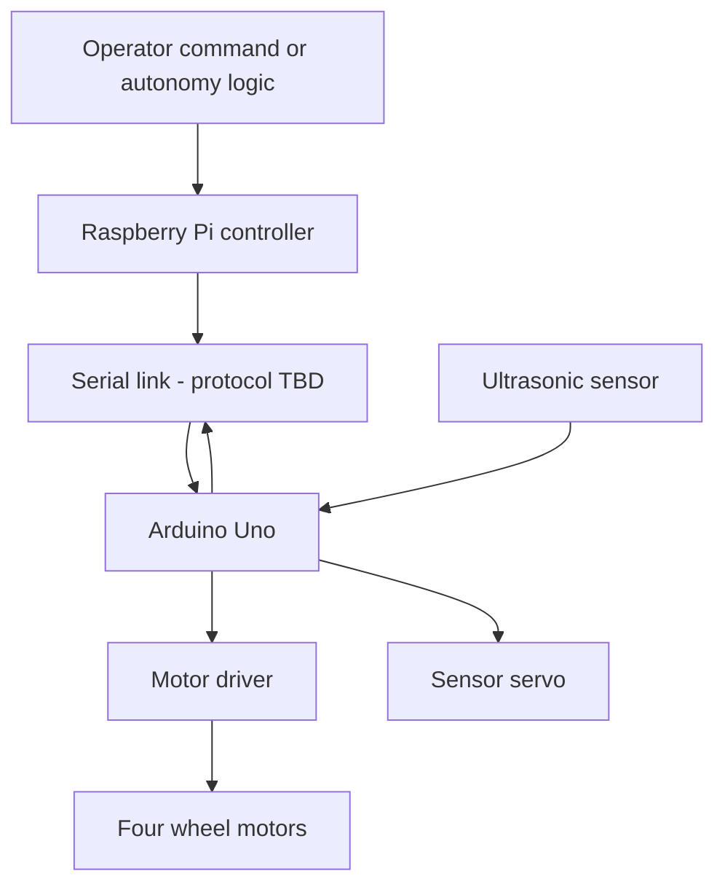

# Software architecture and implementation plan

This is a proposed architecture, **not a claim that the software is already implemented**.

## Proposed responsibilities

## Suggested milestones

1. Verify power distribution, grounds and voltage levels.
2. Identify Arduino pins connected to the motor driver and ultrasonic sensor.
3. Test each motor independently at low duty cycle.
4. Implement and document forward, reverse, left, right and stop commands.
5. Add distance readings and servo movement with timestamped serial logs.
6. Define a serial command protocol between Raspberry Pi and Arduino.
7. Implement obstacle-stop behavior and test failure cases.
8. Add higher-level navigation only after manual control is reliable.

## Suggested serial protocol

Example **design proposal**, not an existing implementation:

- `FWD 120`: request forward motion at a bounded speed value
- `REV 120`: request reverse motion
- `LEFT 100`, `RIGHT 100`: turning commands
- `STOP`: immediate stop request
- `DIST?`: request distance measurement

A real implementation should validate input ranges, include a communication timeout that stops motors, and define acknowledgements and error responses.

## Test evidence to collect

- Controller and firmware versions
- Wiring and power measurements
- Serial logs for every command
- Motor direction and stop tests
- Ultrasonic distance comparison against measured objects
- Communication-loss stop test
- Short demonstration video
